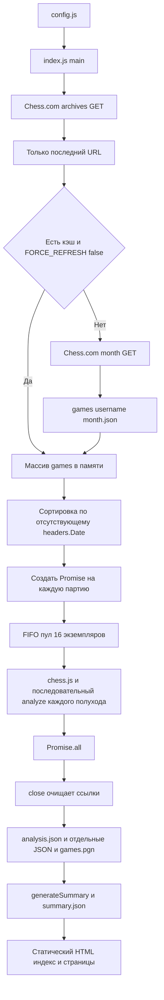

# Текущая архитектура

Аудит 24.11.2026, каталог D:/stockfish. Это исполняемая программа Node.js с ES modules и генерацией статического HTML. Отдельных frontend/backend приложений, HTTP listener, СУБД, Docker, миграций, CI и тестового набора нет. Данные лежат непосредственно в рабочем каталоге. В этой поставке нет .git; git status завершился ошибкой «not a git repository». Историю, ветки, upstream и чистоту Git подтвердить невозможно. AGENTS.md в корне, lib и родительском D:/ не обнаружены. Предыдущего docs/audit до начала аудита не было.

## Инвентаризация собственных компонентов

| Файл / каталог | Назначение, точки входа | Фактические зависимости / ограничения |
|---|---|---|
| package.json, package-lock.json | Манифест stockfish@1.0.0, main=index.js, type=module | Две зависимости; test — echo и exit 1. start/build/dev скриптов нет |
| config.js:1–6 | USERNAME, FORCE_REFRESH=false, MAX_GAMES=0, DEPTH=12, PAUSE_MS=1000, POOL_SIZE=16 | Статический JS конфиг; PAUSE_MS не импортируется и не используется |
| index.js:13–109 | main, непосредственный вызов при импорте | Оркестрация HTTP, кэша, всех задач, записи всех файлов и отчётов |
| lib/chess-api.js:1–14 | getArchives, getGamesForMonth | global fetch; без стороннего HTTP клиента |
| lib/file-utils.js:5–28 | saveGamesToFile, loadGamesFromFile, saveAnalysisResults | JSON/PGN, fs/promises; перезапись, без транзакций |
| lib/stockfish-pool.js:3–48 | StockfishPool.init/acquire/release/close | Собственный FIFO пул поверх Stockfish wrapper; close не завершает процессы |
| lib/analyzer.js:36–154 | analyzeGame | chess.js, выдаваемый пулом engine; внутри парсинг, участник, рейтинг, позиции, оценка, loss, фазы и категории |
| lib/stats.js:12–228 | generateSummary, printSummary | Чистый расчёт из массива результатов; нет I/O в generateSummary |
| lib/html-reporter.js:21,455,527 | generateGameHTML, generateIndexHTML, generateHTMLReport | Строковые HTML/SVG, встроенный JS tooltip; только последняя функция экспортируется |
| games/{username}/{YYYY-MM}.json | Сырой массив API game | Один username, один месяц; 390 объектов |
| analysis/{username}/{YYYY-MM}/ | analysis.json, summary.json, games.pgn, games/*.json, html/*.html | 390 результатов, 390 отдельных JSON, 390 отчётов и index.html |
| node_modules/ | Установленные зависимости, около 79 MB WASM движка | Не собственный код; проверены только публичный контракт wrapper, версии и лицензионные заголовки |
| docs/audit/ | Новый комплект аудита | Единственный каталог, в который внесены изменения |

Незавершённые эксперименты по отдельным каталогам не обнаружены. TODO/FIXME в собственных исходниках не найдены: это не свидетельство завершённости. Комментарии содержат устаревшие слова «как на скриншоте», «без изменений», дублированный JSDoc html-reporter:15–20. Разбор cp дублируется в analyzer:27, stats:3 и reporter:6; в stats parseEval вообще не вызывается. Самописный пул частично повторяет StockfishPool из wrapper, но переносить его поведение без проверки не следует.

## Фактический стек

| Технология | Версия / подтверждение | Применение | Решение |
|---|---|---|---|
| JavaScript ESM | package.json type=module | Все 8 собственных JS файлов | Сохранить; явные DTO/проверки типов вводить постепенно |
| Node.js | В среде v24.19.0; engines не задан | fetch, fs, child_process через wrapper, main | Сохранить; документировать поддерживаемую версию |
| npm | В среде 11.17.0, package-lock есть | Установка двух зависимостей | Сохранить lock; чистая установка не проверена |
| chess.js | manifest ^1.4.0, lock/installed 1.4.0, BSD-2-Clause | PGN/SAN/LAN/FEN, легальные ходы | Сохранить; есть подходящая реализация правил |
| @se-oss/stockfish | manifest ^1.0.1, lock/installed 1.0.1, MIT wrapper | UCI процесс и разбор ответа | Сохранить условно; протестировать ошибки, framing stdout и lifecycle |
| Stockfish.js | id name: Stockfish 17.1 WASM Multithreaded, файл stockfish-17.1-8e4d048 | Отдельный процесс node на каждый экземпляр | Сохранить; native backend рассматривать только после измерений |
| HTML5/CSS/SVG и встроенный JS | Без framework/version pin | Таблицы, два графика, mouse tooltip | Сохранить как экспорт; для интерактивного приложения нужен отдельный слой |
| JSON/PGN/fs | Встроенные Node APIs | Полное файловое хранилище | Сохранить исходные артефакты; добавить нормализованное транзакционное хранилище |

React/Vue, UI kit, charting library, шахматная доска, backend framework, ORM, SQL, Redis, брокер задач, тестовый framework, контейнеры и deploy tooling в проекте отсутствуют. Версии транзитивных dev tools из package.json зависимости не являются стеком приложения.

## Поток выполнения

Фонового сервиса нет: все задачи живут в одном процессе CLI; двигатели — дочерние node-процессы, очередь waiting — массив callback. Асинхронны HTTP/fs/ожидание движка. Синхронны PGN parsing, обходы объектов, sort, JSON.stringify и конструирование HTML; они занимают главный event loop. Статистика рассчитывается после всего анализа, а не по запросу или инкрементально.

## Развёртывание и запуск

Вывод из кода: `node index.js` из D:/stockfish; относительные пути привязаны к cwd. Нужны Node с global fetch, установленные зависимости, доступ к Chess.com и права записи games/analysis. API ключей/паролей не требуется. env переменные приложение не читает. При любом наличии кэша всё равно сначала запрашиваются archives, то есть полноценного offline режима нет. Запуск main в ходе аудита не выполнялся: MAX_GAMES=0 и pool=16 запустили бы анализ всего месяца с перезаписью данных. Безопасно отдельно проверены модули и один engine.

## Пригодность архитектуры

Сохранить выделенный Chess.com адаптер, чистую generateSummary, chess.js, файловый raw слой и автономный HTML экспорт. Разделение по lib полезно, но analyzer совмещает несколько доменных обязанностей, main имеет жёсткую связанность конфигурации/сети/вычислений/записи. Пул не имеет надёжного lifecycle. Тестируемость возможна благодаря передаваемому pool — это использовано в verify.mjs. Для будущего Lichess нужен source-specific adapter и единая Game DTO, а не замена PGN/движка. Для нескольких пользователей недостаточно username в путях: нужны owner/profile IDs и проверка доступа в каждом запросе. Рационален модульный монолит и worker, отдельные микросервисы не обоснованы.
