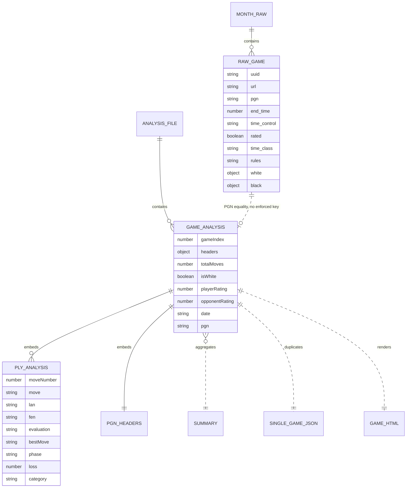

# Аудит модели данных

СУБД, SQL схемы, таблицы, ORM и миграции отсутствуют. Никакая работающая БД не проверялась, подключения к ней в коде нет. Реальное хранилище — JSON и PGN. Следующая ER-диаграмма показывает **логическую вложенность файловых объектов**, а не несуществующие SQL таблицы.

## Реальные поля и потери

| Слой | Что хранится | Чего нет / риск |
|---|---|---|
| Сырой month JSON | Все поля полученного data.games: url, pgn, time_control, end_time, rated, tcn, uuid, initial_setup, fen, time_class, rules, white/black и eco в данном наборе | Не сохраняются сам envelope ответа, HTTP заголовки/ETag/Last-Modified, время получения и список archives |
| Вложенные white/black | username/rating/result и дополнительные исходные поля, если API прислал | Нормализации участников, owner, доступа, истории профиля нет |
| PGN/headers | Исходный pgn полностью; результат chess.header(), Elo, Date и другие имеющиеся теги | Теги неполны и невалидируемы; отсутствующий rating -> null, некорректный parseInt -> NaN -> null при JSON.stringify |
| Результат партии | gameIndex, headers, totalMoves, analysis, pgn, isWhite, рейтинги, date | Нет явных uuid/url, rules/time_class/rated/end_time в результате; они иногда дублируются в PGN, но это не контракт |
| Полуход | 9 полей на диаграмме, fen ДО хода | Нет явного color, fullmove, fen_after, score POV, отдельного mate/cp, depth/nodes/PV/WDL, engine version/options/time, анализа последней позиции |
| summary.json | 26 полей базовой статистики, top5 и категории | Нет provenance, фильтра выборки, версии формул/движка, времени расчёта и статуса полноты |
| games.pgn | Конкатенация исходных PGN | Нет аннотаций engine анализа и интерактивной кнопки экспорта |

Уникальные UUID имеются в raw: в 390 локальных объектах повторов UUID нет. Код не проверяет уникальность и не делает upsert. gameIndex — индекс в массиве текущего запуска, не устойчивый ID. Имена game_N_date зависят от порядка; изменение сортировки меняет связь с прежними файлами. Старые файлы остаются после запуска на меньшем наборе — нет manifest поколения и очистки только соответствующих артефактов. Связь raw→analysis определяется PGN/порядком и никак не контролируется ключом.

Сырой API сохраняется на уровне объектов game, поэтому большинство исходных данных не теряется. Однако «полный исходный ответ API» в строгом смысле не сохраняется: envelope/метаданных нет. Clock-комментарии остаются в PGN (29 957 в наборе); времени обдумывания и duration как чисел нет. Начало/окончание, причины завершения, opening/ECO и точность Chess.com зависят от конкретного объекта и тегов; нельзя обещать наличие каждого поля во всех партиях. В данном raw поле accuracies отсутствует. Фактические formats: rapid и daily, все rules=chess.

Все 390 PGN успешно загружены chess.js, длины history соответствуют analysis.length, всего 30 607 полуходов. Дополнительная проверка всех verbose Move.before/SAN/LAN дала **0 расхождений** с сохранёнными fen/move/lan; PGN каждого analysis совпадает с raw по тому же индексу. Ни один raw объект не имеет headers. Это подтверждает восстановимость и позиционную согласованность **локального** набора (dataset-integrity.json). Общий analyzer при этом не гарантирует SetUp/FEN: отдельный контрпример выявил дефект. Чтение повреждённого JSON и PGN не имеет карантина; сохранение неатомарно. Один сбой записи может оставить частичный файл. Невалидный username молча считается чёрными, отсутствующий Date превращается в null и приводит к различным именам ссылок в HTML.

## Отсутствующие сущности

Нет app_user, chess_profile, sync_job/checkpoint, analysis_job/run/version, position_cache, opening/variation, tactical_motif, positional_feature, session, skill_profile, recommendation, puzzle, training_attempt, user_settings. Game/participant/ply/position/analysis/aggregate представлены частично вложенными JSON, а не нормализованными сущностями. Для каждого пункта исходного задания отдельный статус дан в R7-*.

SQL primary/foreign keys, индексы, views/materialized views, triggers, DB functions неприменимы к текущему хранилищу. Отсутствуют также файловые аналоги транзакций, схемы/валидации, блокировок, backup/restore, retention и referential integrity. generateSummary позволяет пересчитать существующую сводку без Stockfish; добавить новые признаки из несохранённых PV/WDL/depth уже нельзя без дополнительного анализа.

## Масштабирование

raw занимает 1 516 509 B; весь analysis (включая копии JSON/PGN/HTML) 52 061 496 B, около 133.5 kB на партию. Сам analysis.json — 11 334 553 B. JSON.stringify/parse монолитного массива и одновременное хранение результатов требуют существенно больше файлового объёма в RAM; коэффициент не измерялся. Объём линейный, но на 100k партий полный набор файлов и full-memory export ненадёжен. Нет индексов для периода/цвета/дебюта, выборки требуют сканирования. Точное количество RAM не выдаётся за измеренное.

## Рекомендуемая модель — проект, не выполненная миграция

Начать с SQLite для личной локальной установки: raw_snapshot(id, source, fetched_at, payload, headers), profile(id, owner_id, source, username_normalized), game(id, source_game_id UNIQUE, raw_snapshot_id, start/end, rules, rated, time_class, time_control, pgn, initial_fen), participant(game_id,color,profile_id,username,rating,result), ply(game_id,ply,color,fullmove,san,uci,fen_before,fen_after,clock,spent), analysis_run(id,engine_build,options_hash,formula_version,status), position_analysis(position_key,run_id,score_kind,score_value,pov,pv,depth,nodes,wdl), move_analysis(game_id,ply,run_id,loss,category), sync_job и analysis_job с checkpoint/lease. Даты в UTC, display timezone отдельно. Ограничения UNIQUE(game_id,ply), UNIQUE(source,source_game_id), FK и NOT NULL по проверенному контракту. Индексы profile/end_time, format/end_time, run/status, position/cache key. Хранить исходный PGN и raw при любом пересчёте.

SQLite не устанавливался. PostgreSQL нужен при подтверждённых одновременных пользователях/worker writers и требованиях сервера; Redis/Celery и отдельный брокер сейчас не обязательны. Cache key должен включать позицию с историческими ограничениями, engine build, NNUE/options, режим/лимит; один piece-placement FEN не эквивалентен полному состоянию для повторений и 50 ходов. Продумать хранение history и признаки безопасной переиспользуемости анализа.
