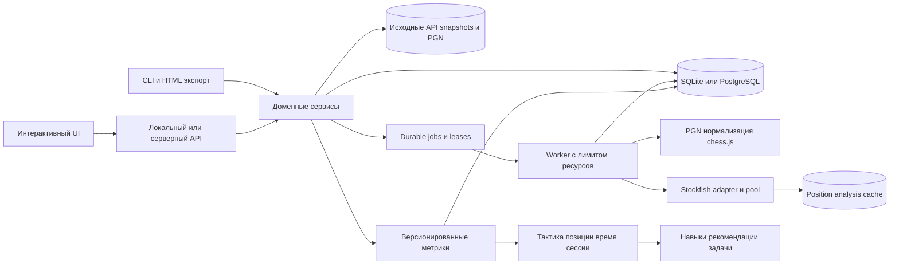
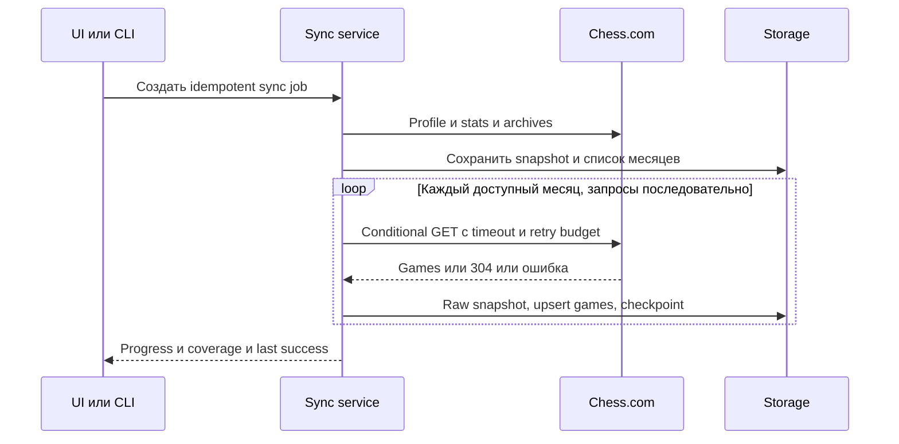
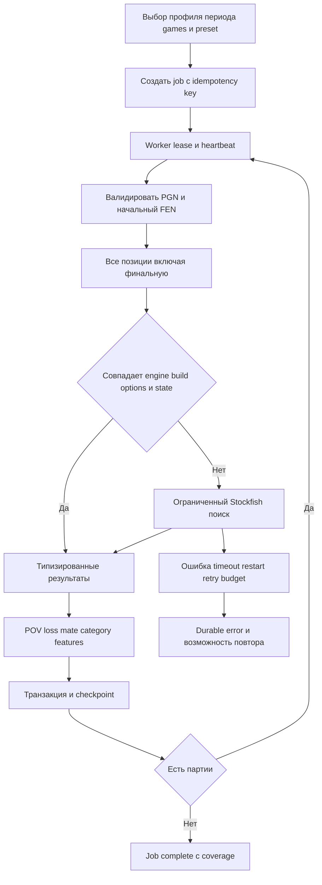
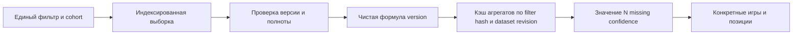

# Предлагаемая целевая архитектура

Это проектное предложение, не описание уже реализованных компонентов. Никаких изменений приложения, миграций или установок в аудите не выполнено. Сохраняем Node.js/chess.js/Stockfish и накопленные raw/PGN; наращиваем надёжность модульного монолита с отдельным процессом worker. Микросервисы и отдельный брокер не требуются на старте.

## Сохранить, изменить, создать

| Компонент | Решение | Обоснование |
|---|---|---|
| chess.js | Сохранить | PGN/правила подтверждены; исправлять использование начальной позиции, не переписывать шахматные правила |
| Raw JSON и исходные PGN | Сохранить неизменными | Восстановление партий и повторная нормализация; 390 партий уже доступны |
| Chess.com adapter | Доработать | Малый модуль с двумя корректно оформленными URL; добавить profile/stats, HTTP policy и валидацию |
| generateSummary | Сохранить идею чистых функций, переработать формулы | Можно воспроизводить и тестировать без движка; текущие знаменатели/attribution неверны |
| HTML reporter | Сохранить как экспорт, исправить escaping/графики | Независим от сервера, пригоден для offline отчётов |
| Stockfish wrapper | Сохранить условно, закрыть адаптером | Реальный запуск подтверждён; lifecycle/framing/timeout требуют тестов. Замена на native — только по измерению |
| Самописный pool/main/analyzer | Существенный рефакторинг отдельной задачей | Явный ownership процессов, bounded concurrency, domain contracts, отделение парсинга/оценки/классификации |
| Storage / jobs | Создать | SQLite и транзакции для локального режима, durable job/lease/run schema |
| Backend API / интерактивный frontend | Создать | Сейчас отсутствуют. Framework выбрать по объёму, компетенциям и модели установки |
| Analytics modules / recommendations / training | Создать | Числовой engine score не заменяет эти подсистемы |

SQLite — минимальная новая технология для транзакций/индексов/локальной поставки. PostgreSQL — при подтверждённом серверном multi-user доступе или высокой write concurrency. Redis/RabbitMQ добавлять только при обоснованной потребности нескольких хостов. TypeScript допускается постепенно для контрактов, не требуется тотальная миграция прежде исправления P0. Новый chart/chessboard UI выбирать после backend DTO и интерактивного review прототипа. LLM для рекомендаций необязательна: сначала объяснимые правила с evidence и privacy contract.

## Импорт

Обновлять активные месяцы по cache policy, неизменившиеся завершённые архивы подтверждать conditional GET; неизменность нельзя считать гарантией API навсегда. Партии хранить по source+UUID, fallback identity документировать. Не терять raw при невалидном PGN: карантин и per-game error. Сначала определяем rules/SetUp/FEN, сохраняем обе стороны, timestamps UTC и clocks.

## Анализ

Один engine выполняет одну задачу поиска в момент времени. CPU budget ≥ workers*Threads плюс reserve; Hash и RSS budget отдельно. Cancel должен прерывать go, корректно завершать/возвращать engine и фиксировать статус; pause останавливает выдачу новых задач и сохраняет checkpoint, не теряет результат уже завершённого поиска. Lease expiry позволяет recovery без двойной записи. Unique job/game/run и транзакционный commit обеспечивают идемпотентность.

## Статистика и расширения

Базовые count/result/rating/time metrics можно считать без Stockfish. Аналитика качества требует проверенных move results, motifs/features — отдельного слоя с provenance. Общие агрегаты по дню/profile/format/color целесообразно пересчитывать инкрементально; произвольные редкие фильтры — по индексированной выборке. Кэш инвалидировать по изменению dataset/run/formula, а не бесконечно по наличию файла. Рекомендации обязаны ссылаться на cohort/N и конкретные примеры, тренировки — на проверенную линию решения и оригинальную партию. Пользовательский skill profile не строить из текущих недостоверных loss.
